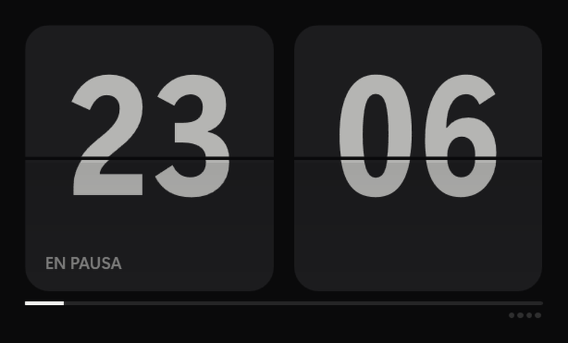
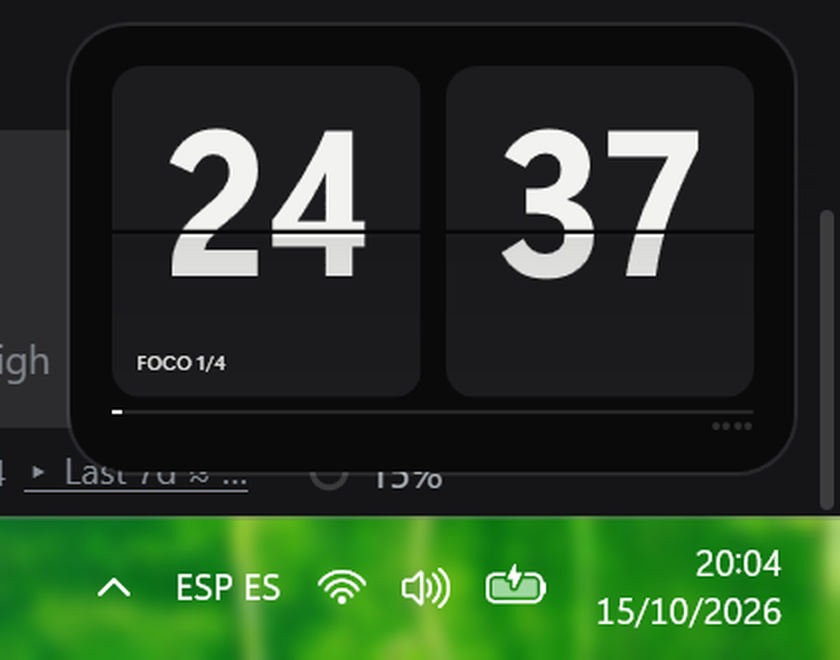

<div align="center">

# Flip Focus

**A flip-clock focus timer that lives in the corner of your screen.**

Tiny window, always on top, under 60 MB of RAM. No account, no telemetry, no ads.

[**Download for Windows**](https://github.com/otamendez11/flip-focus/releases/latest) · [Español](#español) · [How it works](#how-it-works)

</div>



## What it is

A pomodoro-style focus timer built around a split-flap clock. The digits really
flip, like the departure boards at an old train station. You can leave it small
in a corner of your desktop and forget about it until it chimes.

- **Mini mode.** A small window anchored to any corner, always on top of every
  other window, never stealing your focus while you type.
- **Fullscreen mode.** Black screen, huge clock, nothing else.
- **Settings.** Session lengths, how many sessions per cycle, sizes, opacity,
  sounds, notifications and shortcuts, all applied live.
- **Singing bowl chime.** Synthesised inside the app, no audio files. A soft bowl
  when a session ends and another when the next one starts.
- **Blunt quotes.** Three per focus session, at random moments, with their author.
  They fade in, wait a few seconds and leave. Move the mouse over one and it goes.
- **Tray icon and global hotkeys.** Works from any program.



## Download

Grab the latest `FlipFocus-<version>-win-x64.zip` from
[Releases](https://github.com/otamendez11/flip-focus/releases/latest), unzip it
anywhere and run `FlipFocus.exe`. It is self-contained: **no .NET install needed**.

Windows 10 or 11, 64 bits.

> The binary is not code-signed yet, so SmartScreen may warn you the first time.
> Click *More info* then *Run anyway*, or build it yourself from source.

## Shortcuts

With the window focused:

```
Space      start or pause
Esc        leave fullscreen
F          fullscreen
M          mini mode
N          normal mode
A          settings
R          restart the current phase
S          skip phase
C          restart the cycle
```

From any program (the modifier can be changed to Ctrl+Shift in settings):

```
Ctrl + Alt + P    start or pause
Ctrl + Alt + M    mini / normal
Ctrl + Alt + F    fullscreen
Ctrl + Alt + C    restart cycle
Ctrl + Alt + A    settings
Ctrl + Alt + R    restart phase
Ctrl + Alt + N    turn notifications on or off
Ctrl + Alt + H    hide or show the window
```

Mouse: click the clock to start or pause, drag it to move it, right click for the
full menu, click the taskbar icon to bring it back or minimise it.

## How it works

- Three sessions of focus per cycle with short breaks, then a long break. The
  counter resets by itself when the long break ends, and you can start over any
  time with the **C** key or the button in settings.
- Notifications have three states: never, only when the window is hidden in the
  tray (the useful one: close it, go work, get told when the session ends), or
  always.
- Everything is stored in `%APPDATA%\FlipFocus\settings.json`. The app never
  connects to the internet.

## Resource use

Measured on an 8-core Windows 11 machine, mini mode:

```
idle ................ 47 MB private   0.1 % CPU
running, flip on .... 61 MB private   1.8 % CPU
running, flip off ... 58 MB private   0.8 % CPU
```

The flip animation and showing seconds are the only things that cost CPU, because
they redraw the clock. Both can be turned off in settings if you want the minimum.

## Build from source

Needs the .NET 9 SDK.

```bash
git clone https://github.com/otamendez11/flip-focus.git
cd flip-focus
dotnet build -c Release
dotnet run -c Release
```

To produce the self-contained package:

```bash
dotnet publish -c Release -r win-x64 --self-contained true -p:PublishSingleFile=false -o dist
```

## Privacy

No telemetry, no network calls, no analytics. The only thing the app writes is
your settings file. The quotes are real quotes from real people, bundled in the
source code.

## License

MIT. Do whatever you want with it.

---

## Español

**Un temporizador de foco con reloj de pestañas que vive en la esquina de tu
pantalla.** Ventana pequeña, siempre encima, por debajo de 60 MB de memoria. Sin
cuenta, sin telemetría, sin publicidad.

Descarga el último `FlipFocus-<version>-win-x64.zip` desde
[Releases](https://github.com/otamendez11/flip-focus/releases/latest),
descomprímelo donde quieras y ejecuta `FlipFocus.exe`. Es autocontenido: no hace
falta instalar .NET.

Tres sesiones de foco por ciclo con descansos cortos, y descanso largo al
terminar. Cuenco tibetano sintetizado, frases contundentes con su autor, modo
mini siempre visible y pantalla completa. Los atajos y el resto están explicados
en `LEEME-es.txt`, dentro del paquete.

Los ajustes se guardan en `%APPDATA%\FlipFocus\settings.json` y la app no se
conecta a internet.
